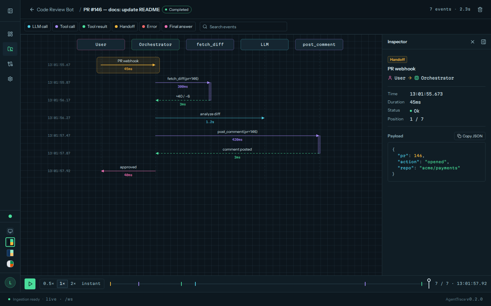
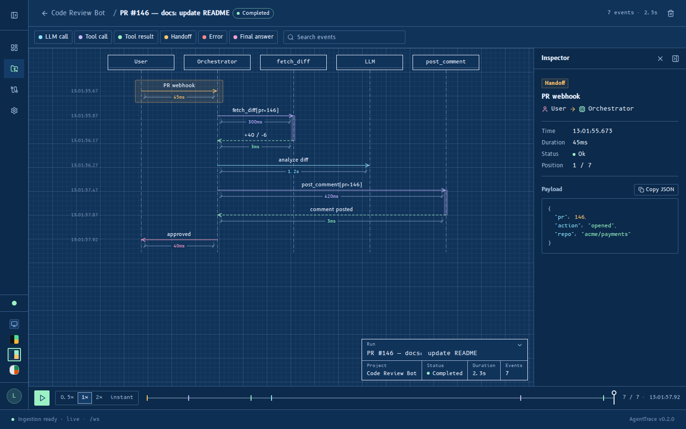
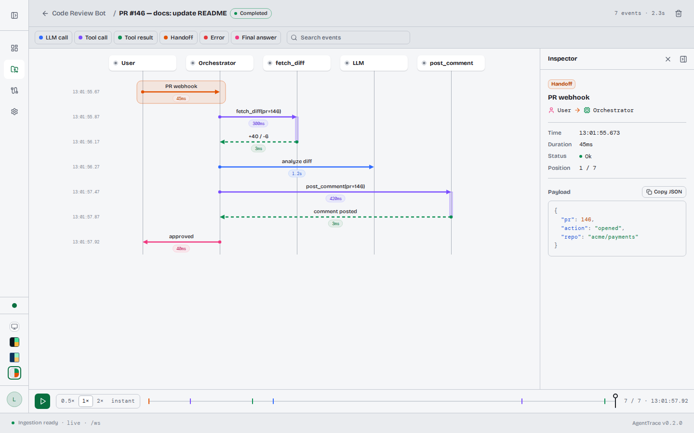

# AgentTrace

> A live sequence diagram for AI engineers building autonomous and multi-agent systems. Stream LLM calls, tool calls, handoffs, and errors — then replay any run frame by frame.

Watch signals move through your agents in real time: one vertical lifeline per participant (User, Orchestrator, LLM, each Tool, each Sub-agent), each event rendering as an animated arrow in a UML-inspired sequence diagram.



## Themes

AgentTrace ships three themes, each with its own palette, typography and motion.

| Phosphore | Cyanotype | Studio |
| --- | --- | --- |
|  |  |  |
| Dark oscilloscope: phosphor-green glow, mono labels, arrows that draw like a beam. | Dark blueprint: drafting-table blues, technical type, arrows that plot in crisply. | Light and calm: paper surfaces, soft shadows, arrows that settle with a spring. |

Switch themes with the swatches at the bottom of the sidebar, or in Settings →
Theme. **Auto** (the default) follows your OS: dark picks Cyanotype, light picks
Studio. Your choice is remembered in the browser. All motion respects
`prefers-reduced-motion`: animations shrink to a short fade with no travel.

## Stack

- **FastAPI** backend, shipped in the `deepagents-trace` Python package (SQLAlchemy; SQLite by default, Postgres optional), with a plain-JSON `/ws` live stream
- **Next.js 16** (TypeScript, static export) — a build tool only: the exported UI is bundled into the Python package and served by FastAPI, so no Node/Bun runtime is needed to run AgentTrace
- **Tailwind CSS 4** + **shadcn/ui** (oscilloscope / phosphor aesthetic)
- **TanStack Query** + **Zustand** for server/client state
- **Framer Motion** for the animated SVG diagram

## Quick start

```bash
pip install 'deepagents-trace[server]'
agenttrace demo          # seed sample projects and runs into ./agenttrace.db
agenttrace ui            # open http://127.0.0.1:3000
```

`agenttrace demo [--database-url URL]` seeds three sample projects (Customer
Support Agent, Research Assistant, Code Review Bot) for the local (no-auth)
user that `agenttrace ui` uses on loopback. In password mode, signed-in users
load them from Settings → Demo data → "Reload demo projects". `agenttrace ui [--host H]
[--port P] [--auth none|password] [--database-url URL]` serves the dashboard on
`http://127.0.0.1:3000` by default; auth is `none` on loopback (no login) and
`password` on any other host. For the MLflow-style local flow
(`agenttrace.langchain.autolog()` writing to `./agenttrace.db`) see the
[python-server README](python-server/README.md#quick-start-mlflow-style).

### Configuration

| Variable | Used by | Meaning |
| --- | --- | --- |
| `DATABASE_URL` | server | Database to serve (default: local `./agenttrace.db`) |
| `AGENTTRACE_SECRET` | server | Session-signing secret for password mode. If unset, a random per-process secret is used and sessions reset on restart |
| `AGENTTRACE_AUTH` | server | `none` or `password` — default for `agenttrace ui --auth` (an explicit `--auth` wins; neither: `none` on loopback, `password` otherwise) |
| `AGENTTRACE_ALLOWED_HOSTS` | server | Comma-separated extra hostnames accepted in `--auth none` mode (e.g. behind a reverse proxy) |
| `AGENTTRACE_TRACKING_URI` | SDK | Where traces go (local DB, SQLAlchemy URL, or `http(s)://` server) |
| `AGENTTRACE_PROJECT` | SDK | Default project name |
| `AGENTTRACE_KEY` | SDK | `atr_` project key for a password-mode server |

Package extras: `server`, `langchain`, `postgres`, `e2e`, `dev`.

## Docker

A single image: a Bun stage builds the UI, then `python:3.12-slim` runs
`agenttrace ui --host 0.0.0.0` as a non-root user (uid 10001, `WORKDIR /data`).

```bash
# Postgres + agenttrace, password auth (AGENTTRACE_SECRET is required)
AGENTTRACE_SECRET=$(openssl rand -base64 32) docker compose up --build

# Or build and run the image directly (SQLite in /data; keep it in a volume)
docker build -t agenttrace .
docker run -p 3000:3000 -e AGENTTRACE_SECRET=$(openssl rand -base64 32) \
  -v agenttrace-data:/data agenttrace
```

`docker-compose.yml` runs Postgres alongside the `agenttrace` service, which
connects with `DATABASE_URL=postgresql+psycopg://...`. Compose refuses to start
unless `AGENTTRACE_SECRET` is set (put it in `.env`, see `.env.example`). With
bare `docker run` and no `DATABASE_URL`, the server uses SQLite at
`/data/agenttrace.db`: mount a volume on `/data` (as above) or the data is lost
with the container; without `AGENTTRACE_SECRET` a random secret is used and
sign-ins reset on every restart.

The image runs in password mode, so sign up in the browser and load sample
projects from Settings → Demo data → "Reload demo projects".
`agenttrace demo` only seeds the local (no-auth) user and has no visible
effect on a password-mode server.

## Development

Backend:

```bash
pip install -e "python-server[dev]"      # or: uv pip install -e "python-server[dev]"
agenttrace ui --auth none                # API + /ws on :3000
pytest python-server/tests
```

UI (hot reload):

```bash
bun install
NEXT_PUBLIC_AGENTTRACE_WS_URL=ws://localhost:3000/ws bun run dev   # http://localhost:3001
```

REST calls from the dev server are proxied to `:3000` by Next rewrites
(override with `AGENTTRACE_DEV_BACKEND`). `bun run build:ui` rebuilds the static
export and refreshes `python-server/agenttrace/server/static/` (git-ignored);
run it before testing the bundled UI from a source install. Also:
`bun run lint`, `bun run typecheck`.

End-to-end tests (Playwright, against the bundled UI):

```bash
pip install -e "python-server[dev,e2e]" && playwright install chromium
bun run build:ui
pytest python-server/tests_e2e
```

## CI

`.github/workflows/ci.yml` runs on every push and pull request:

1. **ui** — lint, typecheck and build the static export, uploaded as an artifact
2. **python** (needs ui) — unit tests, builds the wheel with the UI bundled and checks it
3. **e2e** (needs ui) — Playwright tests against the bundled dashboard
4. **docker** — builds the image and smoke-tests it

`publish-pypi.yml` builds the UI before the wheel and runs
`python-server/scripts/check_wheel.py` to make sure the bundle ships.

## Instrumenting an agent

The **Integration** page (in-app) generates copy-pasteable snippets. Three
ways to emit events:

### Python SDK

```bash
pip install deepagents-trace
```

```python
import agenttrace

agenttrace.set_project("support-bot")
with agenttrace.start_run("triage"):
    agenttrace.log_event(source="Orchestrator", target="LLM",
                         type="llm_call", label="classify intent", duration_ms=480)

@agenttrace.trace                      # tool_call -> tool_result | error
def web_search(query: str) -> str: ...
```

Where traces go is controlled by `AGENTTRACE_TRACKING_URI` (unset: local
`./agenttrace.db`; `http(s)://host:port`: a running `agenttrace ui`, with
`AGENTTRACE_KEY` if it uses password auth). `AGENTTRACE_PROJECT` selects the
project. See [python-server/README.md](python-server/README.md).

### Raw HTTP / other languages
See the [event ingestion API](#event-ingestion-api) below; the Integration page
in the app generates snippets with your project's key pre-filled.

### DeepAgents (LangChain)

The DeepAgents snippet provides a drop-in `AgentMiddleware` (deepagents' current
middleware system — `before_agent` / `wrap_model_call` / `wrap_tool_call` /
`after_agent`) that instruments a `create_deep_agent` run. It's also published
as part of `deepagents-trace` (`agenttrace.langchain`); the old
[`integrations/agenttrace-langchain`](integrations/agenttrace-langchain) package is a deprecated shim.
Attach one instance per agent:

```python
# pip install 'deepagents-trace[langchain]'
from agenttrace.langchain import AgentTraceMiddleware
from deepagents import create_deep_agent
from langchain_openai import ChatOpenAI
from langchain_core.tools import tool

@tool
def web_search(query: str) -> str:
    """Search the web."""
    return "..."

agent = create_deep_agent(
    model=ChatOpenAI(model="gpt-4o-mini"),
    tools=[web_search],
    # one middleware instance = one AgentTrace run
    middleware=[AgentTraceMiddleware(run_name="research — Rust frameworks")],
)

result = agent.invoke(
    {"messages": [{"role": "user", "content": "What's the state of Rust web frameworks?"}]}
)
```

Emission is non-blocking (background thread + queue, so it never adds latency
to a model/tool call) and never fatal (a misconfigured or unreachable
AgentTrace instance silently disables tracing for the run instead of breaking
the agent) — see the package
[README](integrations/agenttrace-langchain/README.md#reliability) for details.

Or skip the middleware entirely: `agenttrace.langchain.autolog()`.

The middleware streams, in real time:

| Event type     | Emitted from                    | Diagram arrow              |
| -------------- | -------------------------------- | ---------------------------- |
| `llm_call`     | `wrap_model_call`                | Orchestrator → LLM           |
| `tool_call`    | `wrap_tool_call` (before)         | Orchestrator → tool          |
| `tool_result`  | `wrap_tool_call` (after)          | tool → Orchestrator          |
| `handoff`      | `wrap_tool_call` (handoff tool)   | Orchestrator → Sub-agent     |
| `error`        | `wrap_tool_call` (exception)      | tool → Orchestrator (red)    |
| `final_answer` | `after_agent`                     | Orchestrator → User          |

Open the run in AgentTrace while the agent runs to watch the diagram populate
live, or replay it afterward at 0.5× / 1× / 2× / instant.

## Event ingestion API

`POST /api/events` — authenticate with `Authorization: Bearer atr_<key>`.

```jsonc
{
  "runId": "run_abc123",        // null/omit to create a new run
  "source": "Orchestrator",
  "target": "web_search",
  "type": "tool_call",          // llm_call | tool_call | tool_result | handoff | error | final_answer
  "label": "web_search(query)",
  "payload": { "args": { "query": "..." } },
  "durationMs": 720,
  "status": "ok",               // ok | error | pending
  "endRun": "completed"         // optional: "completed" | "failed" to close the run
}
```

## Project structure

```
src/                      # Next.js UI source (static export; build tool only)
  app/                    # App Router pages
  components/
    sequence-diagram/     # the live SVG diagram (centerpiece) + replay
    views/                # dashboard, projects, run, integration, settings
    layout/               # sidebar, footer
    auth/                 # auth screen
  lib/                    # api client, store, types, websocket client
scripts/copy-ui.mjs       # copies the export into the Python package
python-server/            # the `deepagents-trace` package (import `agenttrace`)
  agenttrace/server/      # FastAPI app, routes, realtime /ws, bundled static/
  agenttrace/tracking/    # SDK (set_project, start_run, trace, ...)
  agenttrace/langchain/   # DeepAgents middleware + autolog
  tests/  tests_e2e/      # pytest and Playwright suites
integrations/             # deprecated agenttrace-langchain shim
Dockerfile                # bun UI build + python:3.12-slim runtime
docker-compose.yml        # Postgres + agenttrace
.github/workflows/        # ci.yml, publish-pypi.yml
```
