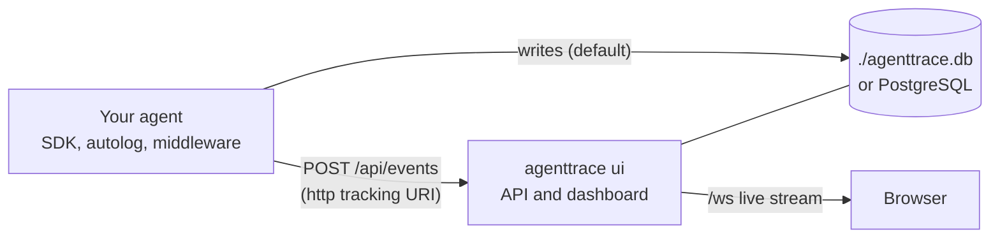

# AgentTrace

AgentTrace shows an AI agent's run as a **live sequence diagram**: one lifeline
per participant (the user, the orchestrator, each LLM, tool and sub-agent) and
one arrow per event, drawn as it happens. Any past run can be replayed at 0.5×,
1× or 2× speed, or shown at once.

It ships as one Python package, `deepagents-trace`, imported as `agenttrace`:

- a **tracking SDK** modelled on MLflow's: `set_project()`, `start_run()`,
  `log_event()`, `@agenttrace.trace`;
- a **LangChain and deepagents integration**: `agenttrace.langchain.autolog()`,
  a middleware and two callback handlers;
- the **dashboard**: `agenttrace ui` serves the API, a WebSocket live stream and
  the web interface, from one Python process (no Node or Bun at runtime).

By default the SDK writes to a SQLite file, `./agenttrace.db`, and
`agenttrace ui` reads that same file. Tracing needs no server, no account and
no API key.

## How it fits together

The [tracking URI](mlflow.md#tracking-uris) decides where runs go: the default
SQLite file, any SQLAlchemy database URL, or a running `agenttrace ui` over
HTTP. The dashboard reads new events from the database, so runs that the SDK
writes there directly show up live as well.

## Pick an integration

| Your code | Use |
| --- | --- |
| LangChain or deepagents, any setup | [`agenttrace.langchain.autolog()`](integration-callback.md#autolog-and-agenttracecallbackhandler): one line, the agent code doesn't change |
| An agent built for each invocation | [`AgentTraceMiddleware`](integration-middleware.md), passed to `create_agent` or `create_deep_agent` |
| An async server that reuses a compiled agent, with sub-agents | [`AsyncAgentTraceCallbackHandler`](integration-callback.md#asyncagenttracecallbackhandler-one-per-request), one per request |
| Any other Python code | the [fluent API](quickstart.md#3-trace-anything-else) |
| Another language | [`POST /api/events`](events.md) |

## Next steps

- :material-download: **[Installation](install.md)**: the package and its extras.
- :material-rocket-launch: **[Quickstart](quickstart.md)**: `agenttrace ui`, then a first trace.
- :material-swap-horizontal: **[Coming from MLflow](mlflow.md)**: the same names, mapped.
- :material-code-json: **[Event contract](events.md)**: the JSON an agent sends.

