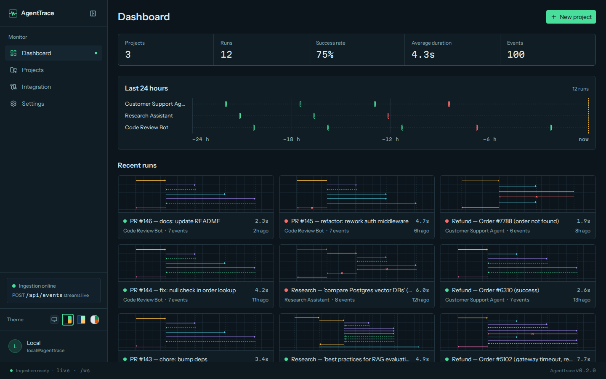
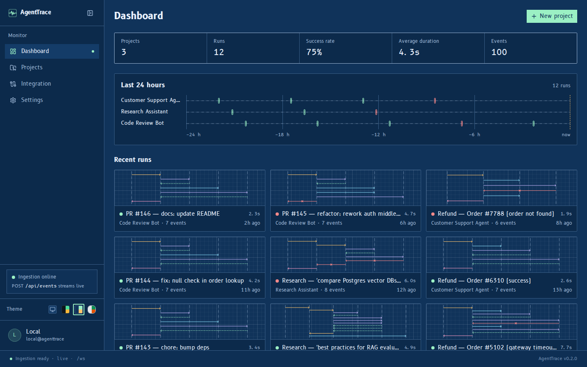
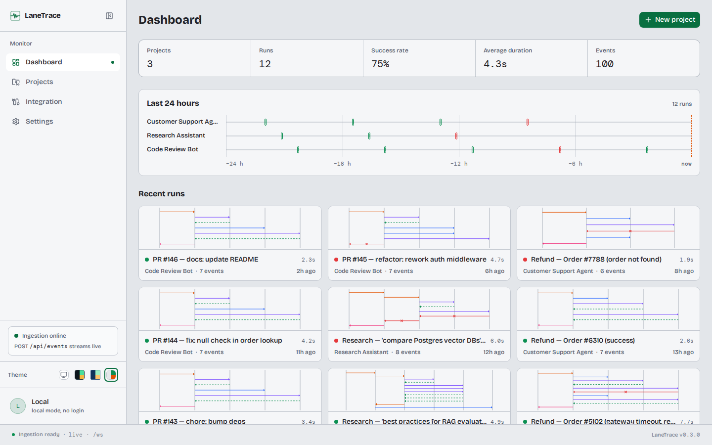

# Themes

The dashboard has three themes, each with its own palette, typography and
motion.

=== "Phosphore"

    Dark, like an oscilloscope: phosphor-green glow, monospaced labels, arrows
    that draw like a beam.

    

    

=== "Cyanotype"

    Dark, like a blueprint: drafting-table blues, technical type, arrows that
    plot in crisply.

    

    

=== "Studio"

    Light and calm: paper surfaces, soft shadows, arrows that settle with a
    spring.

    

    

## Switching themes

Use the **Theme** swatches at the bottom of the sidebar, or Settings → Theme.
**Auto**, the default, follows the operating system: Cyanotype when it is in
dark mode, Studio in light mode. The choice is remembered in the browser.

## Reduced motion

Every animation respects the `prefers-reduced-motion` setting: animations
shrink to a short fade, without movement.
